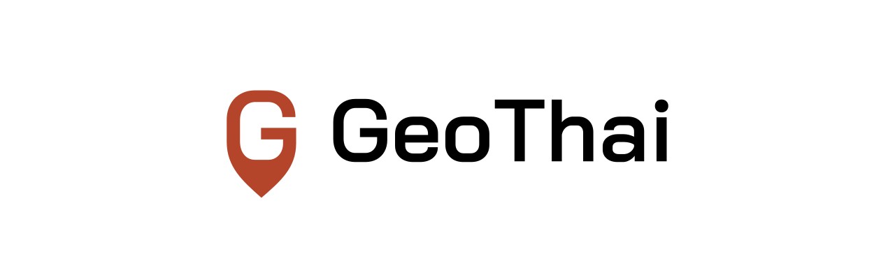

<picture>
  <source media="(prefers-color-scheme: dark)" srcset="./docs/banner-dark.png">
  
</picture>

# GeoThai Brand

The GeoThai logo, colours, icons and usage rules.

See the [overview](./docs/overview.png) and the [presentation](./docs/presentation.html).

## The Logo

**Idea:** the symbol is the G of the wordmark's typeface, with its lower curve drawn out into the tip of a location pin. One letter says the name and the place.

| Version    | Use                                                | Files                                   |
| ---------- | -------------------------------------------------- | --------------------------------------- |
| Horizontal | The default: headers, README, slides               | [`logo/horizontal/`](./logo/horizontal) |
| Stacked    | Square or narrow spaces                            | [`logo/stacked/`](./logo/stacked)       |
| Symbol     | Avatars, app icons, favicons, small spaces         | [`logo/symbol/`](./logo/symbol)         |
| Wordmark   | Text-only contexts, after the symbol already shows | [`logo/wordmark/`](./logo/wordmark)     |

Each version comes in four colourways:

| File suffix      | Symbol         | Wordmark | Background                          |
| ---------------- | -------------- | -------- | ----------------------------------- |
| `-color`         | Laterite       | Black    | White, light tints                  |
| `-color-on-dark` | Laterite Light | White    | Black, dark UI                      |
| `-black`         | Black          | Black    | One-colour print, light backgrounds |
| `-white`         | White          | White    | Photos, Laterite, dark backgrounds  |

## Clear Space

Keep a clear zone of half the wordmark's cap height (**0.5 H**) on every side. The SVG files already include this zone. The zone scales with the logo, so never use a fixed distance.

In the horizontal lockup, the symbol's G is 1.3 H tall and centred on the caps, and the gap to the wordmark is 0.6 H. Do not change these sizes.

## Minimum Size

| Version    | Screen                                                                                                                                 |
| ---------- | -------------------------------------------------------------------------------------------------------------------------------------- |
| Horizontal | 120 px wide                                                                                                                            |
| Stacked    | 64 px wide                                                                                                                             |
| Symbol     | 24 px tall. Below 24 px, use [`logo/symbol/geothai-symbol-small.svg`](./logo/symbol/geothai-symbol-small.svg), which has a longer tip. |

## Colour

| Name           | HEX       | RGB         | CMYK       | Use                             |
| -------------- | --------- | ----------- | ---------- | ------------------------------- |
| Laterite       | `#B5452A` | 181 69 42   | 0 62 77 29 | Symbol, key UI accents          |
| Laterite Light | `#EE8461` | 238 132 97  | 0 45 59 7  | Symbol on dark backgrounds      |
| Black          | `#000000` | 0 0 0       | 0 0 0 100  | Wordmark, text, one-colour logo |
| White          | `#FFFFFF` | 255 255 255 | 0 0 0 0    | Backgrounds                     |

Laterite is the red-brown of laterite stone, the earth of Thai and Khmer temples. It is warm in a category where most brands are blue.

Contrast: Laterite on white is 5.46 : 1. Laterite Light on Black is 8.11 : 1. Black on White is 21 : 1. CMYK values are conversions. Proof them on paper before a print run.

## Typography

- Wordmark and headings: [Bai Jamjuree](https://github.com/cadsondemak/Bai-Jamjuree) SemiBold by Cadson Demak. It has Thai and Latin in one family. Licence: SIL Open Font License, in [`fonts/OFL.txt`](./fonts/OFL.txt).
- Body text: Bai Jamjuree Regular, or the system sans-serif.
- The wordmark in the logo files is outlined. Do not retype it.

## Icons

[`icons/`](./icons) holds the web and app set:

| File                                                                       | Use                                                          |
| -------------------------------------------------------------------------- | ------------------------------------------------------------ |
| `favicon.ico`, `favicon.svg`, `favicon-16/32/48.png`                       | Browser tabs                                                 |
| `apple-touch-icon.png`, `icon-192.png`, `icon-512.png`, `maskable-512.png` | Home screens and PWA                                         |
| `avatar.svg`, `avatar-500.png`, `avatar-1024.png`                          | GitHub org, npm, social profiles (square, crops to a circle) |
| `app-icon.svg`                                                             | App icon master                                              |
| `site.webmanifest`, `head-snippet.html`                                    | Copy into a website                                          |

## Do Not

- Stretch, squash, rotate or slant the logo.
- Recolour it outside the palette, or use Laterite for the wordmark.
- Add shadows, outlines, gradients or effects.
- Move, resize or swap the parts of a lockup.
- Put it on a busy photo without a calm area or a solid panel.
- Use the old logo with the map of Thailand.

## Rebuild

Every logo and icon file is made from the typeface by one script. To change a size or a colour, edit [`scripts/build.py`](./scripts/build.py) and run it:

```bash
pip install fonttools cairosvg pillow
python3 scripts/build.py
```

## License

The GeoThai name and logo: all rights reserved © 2026 [Pongsakorn Thipayanate](https://github.com/pyyupsk). Bai Jamjuree: SIL Open Font License 1.1.
